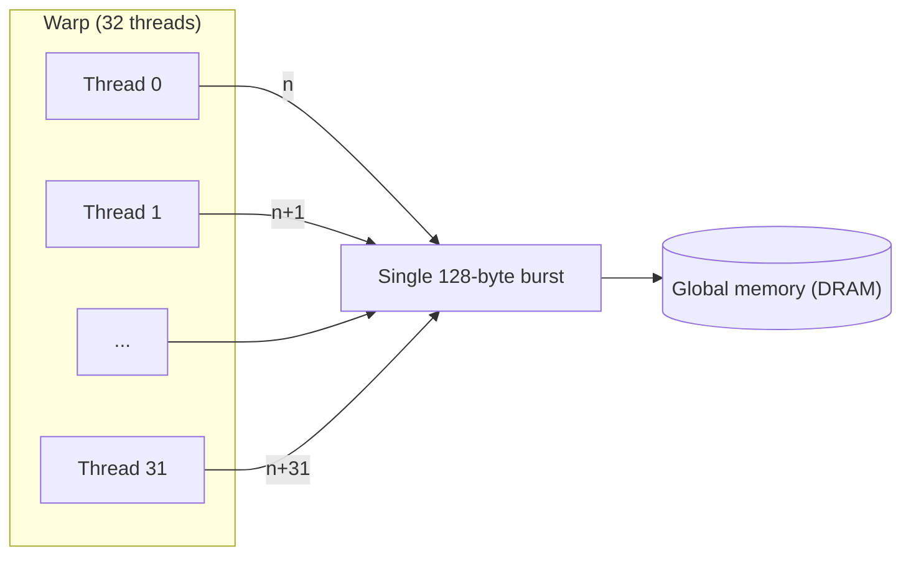
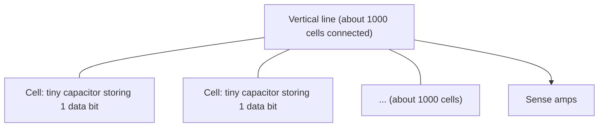
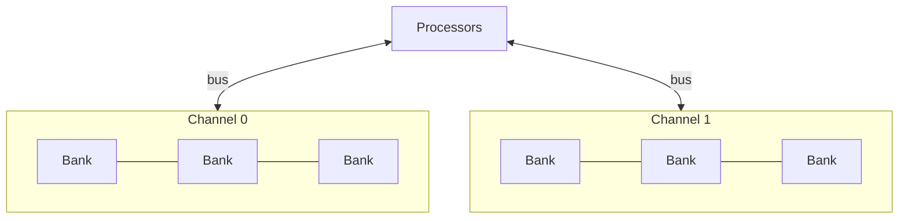
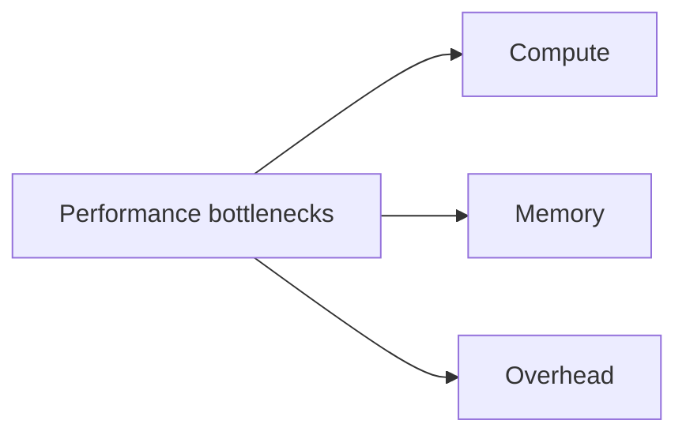

# CUDA

**Chapter → 6**

## Contents

1. [Memory Coalescing](#1-memory-coalescing)
2. [Performance Bottleneck](#2-performance-bottleneck)
3. [Computation's Bottleneck](#3-computations-bottleneck)

---

# 1. Memory Coalescing

## Memory Coalesce

CUDA GPUs' global memory is backed by GPU RAM, built with Dynamic Random Access Memory (DRAM) technologies like GDDR or HBM.

DRAM access latency is limited by the speed at which the small capacitors can charge up their access lanes, which is limited by thermal, power, and size constraints.

Due to high latency, if all logical memory accesses are serviced as separate physical addresses, the GPU's memory bandwidth will not be fully utilized.

If multiple concurrent logical accesses are serviced by a single physical access burst, the access is said to be **coalesced**.

A single burst can service **128 bytes**, enough for each of the 32 threads in a warp to load one 32-bit float.

In a warp:

- Thread 0 accesses location `n`
- Thread 1 accesses location `n+1`
- ...
- Thread 31 accesses location `n+31`

Then all accesses are coalesced, that is: **combine into a single access**.

> [!NOTE]
> **Added diagram:** coalesced access inside one warp.



---

## Shared Memory

★ Shared memory has **32 banks** that are organized such that successive 32-bit words are assigned to successive banks, i.e. **interleaved**.

The bandwidth of shared memory is **32 bits per bank per clock cycle**.

Because shared memory is on chip, uncached shared memory latency is roughly **100 times lower** than global memory latency.

> [!NOTE]
> **Added bank layout:** word `i` lives in bank `i mod 32`.

| Bank → | 0 | 1 | 2 | ... | 31 |
|--------|----|----|----|-----|----|
| Words | 0 | 1 | 2 | ... | 31 |
| Words | 32 | 33 | 34 | ... | 63 |

### Bank Conflict

★ A **bank conflict** occurs if two or more threads access any bytes within **different 32-bit words** belonging to the **same bank**.

> [!NOTE]
> **Added example:** thread A reads word 0 and thread B reads word 32. Both words are in bank 0, so the two accesses are serialized (conflict). If thread A reads word 0 and thread B reads word 1, they hit banks 0 and 1, so there is no conflict.

---

## DRAM Cell

★ Data bits are stored in DRAM cells that are small capacitors, in which the presence or absence of a tiny amount of electrical charge distinguishes between **1** and **0** value.

- About **1000 cells** connected to each vertical line.
- A very small capacitance that stores a data bit.
- It takes time for the sense amps to sense the charge, because the cell needs to be fully charged or discharged.
- Consecutive locations accessed and delivered are referred to as **DRAM bursts**.

> [!NOTE]
> **Added diagram** of your sketch.



---

## DDR

- The data transfer bandwidth of a bus is defined by its **width** and **clock frequency**.
- Modern double data rate (DDR) buses perform **two data transfers per clock cycle**.

> [!NOTE]
> **Added diagram** of sketch.



If the ratio of the cell array access latency and data transfer time is **R**, we need to have at least **R + 1 banks**.

1. Reduce the probability of multiple simultaneous accesses targeting the same bank, called **bank conflict**.
2. The size of each cell array is set to achieve reasonable latency and manufacturability.

---

# 2. Performance Bottleneck



| Category | Problems | Key question |
|----------|----------|--------------|
| **Compute** | Underutilized GPU cores<br>Uneven workload distribution | ★ How efficient are your threads? |
| **Memory** | High memory access latency<br>Frequent cache misses | ★ How fast can the program access my data? |
| **Overhead** | Excessive kernel launches<br>High synchronization costs | ★ Everything else, inefficient algorithm design. |

★ Figuring out block size. That is what NVIDIA's calculator and our profilers are for.

| Work | Bound by |
|------|----------|
| LLM infra / long context | Memory |
| Small batch infra | Memory |
| Large batch training | Compute + Bandwidth |

---

## Thread Coarsening: Definition

Assigning each thread multiple units of work → **thread coarsening**.

A matrix multiplication kernel will:

1. Perform the same number of computations.
2. Perform the same computations in the same order.
3. Access the same memory address.
4. Access the same memory address in the same order.

↳ The culprit in these factors, for a random input type, is **dynamic/switching power** in semiconductors.

---

# 3. Computation's Bottleneck

## Static / Leakage Power

★ We can think of this as the power that inevitably gets lost by just flowing power through circuits. The amount of static power used is proportional to the amount of silicon that is powered.

> **Power gating** is a technique used in integrated circuit design to reduce power consumption, by shutting off the current to blocks of the circuit that are not in use.

## Dynamic / Switching Power

Dynamic/switching power is the culprit of power consumption. A small amount of power is consumed whenever a transistor switches states. On the other hand, if it is rapidly flapping, then it consumes a ton of dynamic/switching power.

```text
power ≈ clock speed * "transistor flips per clock"
```

$$
P_{dyn} \approx \alpha \cdot C \cdot V^2 \cdot f
$$

> [!NOTE]
> **Added symbols:** α = activity factor (how often transistors switch), C = capacitance, V = voltage, f = clock frequency.

⊛ The more transistors and the denser they are relative to the substrate size, the more power is required. This also presents a cooling problem as well. GPUs have more parallel lines compared to CPUs.
